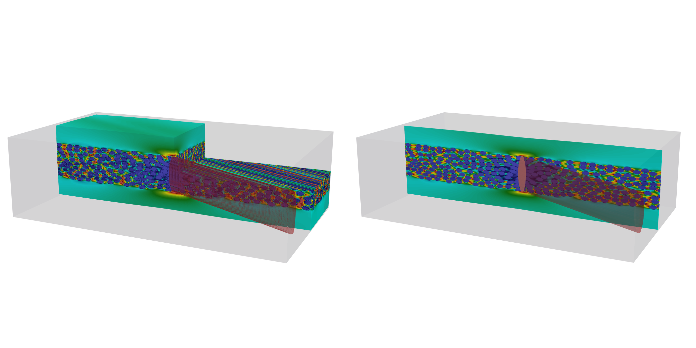

# OA2D

Tunnel cracks and delamination in laminates with the off-axis 2D element: three displacement components on a section of the laminate along the load, nothing varying along the crack, so an off-axis crack, a 3D problem, costs a 2D model.

*Left: a 3D model of a [0/30]s glass/epoxy laminate loaded along its length, a tunnel crack along the fibres of its 30° plies (fibres explicit), cut open at mid-depth (the cut-away parts translucent, the crack red). Right: the off-axis 2D model of that mid-depth section, its crack carried along the crack's direction. Strain along the load, displacements magnified 150 times. The 3D model has 223M degrees of freedom, two solves in 58 s on an RTX 5090 (kernel compilation included); the off-axis model 5.5M, two solves in 1.6 s; both with [cuvox](cuvox/).*

| folder | implementation |
|---|---|
| [`abaqus/`](abaqus/) | the user element `OA2D.f` and the Python scripts that build, run and evaluate the Abaqus models |
| [`cuvox/`](cuvox/) | the same element on GPU voxel grids, with explicit fibres, and the 3D model it stands for |

## Publications

- [*Competition between arbitrarily oriented tunnel cracks and delamination*](https://doi.org/10.1007/s10704-025-00870-2), International Journal of Fracture (2025)
- [*The influence of the fiber-matrix microstructure on the energy release rate of off-axis tunnel cracks in laminates*](https://doi.org/10.1016/j.compositesb.2022.110338), Composites Part B: Engineering (2022)
- [*An efficient stiffness degradation model for layered composites with arbitrarily oriented tunneling and delamination cracks*](https://doi.org/10.1016/j.compscitech.2022.109729), Composites Science and Technology (2022), code on [Zenodo](https://zenodo.org/records/5730309)
- [*A special finite element method applied to off-axis tunnel cracking in laminates*](https://doi.org/10.1016/j.engfracmech.2022.108387), Engineering Fracture Mechanics (2022), code on [Zenodo](https://zenodo.org/records/4421512)

## Licence

[MIT](LICENSE)
